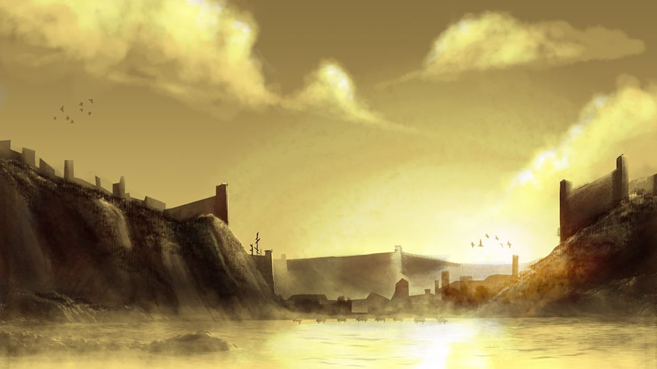

  

  

# Welcome to the online document for **Daunten Cove** 
This is a living document and repository for the development for the Daggerheart Campaign Frame.

[The Pitch](pages/campaign_frame/the_pitch.html){: .btn} [Overview](pages/campaign_frame/overview.html){: .btn} [Communities](pages/campaign_frame/communities.html){: .btn}
[Ancestries](pages/campaign_frame/ancestries.html){: .btn} [Class](pages/campaign_frame/class.html){: .btn} [Player Principles](pages/campaign_frame/player_principles.html){: .btn}
[GM Principles](pages/campaign_frame/gm_principles.html){: .btn} [Distinctions](pages/campaign_frame/distinctions.html){: .btn} [Inciting Incident](pages/campaign_frame/inciting_incident.html){: .btn}
[Campaign Mechanics](pages/campaign_frame/campaign_mechanics.html){: .btn} [Session 0 Questions](pages/campaign_frame/session_zero_questions.html){: .btn} [Downloads](files/Abyssal Cards.zip){: .btn}

---
<!--

<a href="https://www.thecrypthasopened.com">The Crypt Has Opened</a> crowdfunding campaign launches this coming February, 2026. Become a magical practitioner and fight cryptids, ghosts, and cultists in a twisted 90s hellscape.

---
-->

## Welcome To Daunten Cove

### Creation Myth

>In the beginning, the creator, Ithuna, swam in the Oceans of Creation. For time untold she remained there, exploring the depths of the endless waters. In time Ithuna became lonely and despondent of her life of solitude. In despair, Ithuna dove below the frothing surface of the water and headed down to find release from the unending solitude.
>
>As the darkness overtook her she felt the end draw near. Then a light pierced the darkness.
>
>It called Ithuna. Beckoned her forth with a song so pure her tears mixed with the water of the ocean. Thus the stars of the universe were made, hung in the waters of creation.
>
>There she found the Lotus, the heart of the ocean. It had been dormant for all this time, but as Ithuna reached out for it, the Lotus opened to greet her. Its light warmed her and drew her into a deep slumber. Laying on the ocean floor Ithuna wrapped herself around the Lotus and fell into a deep sleep. Through the power of the Lotus and her dreams, the Ocean of Creation boiled. Her splendor drew in the waters and reality began to take shape.
>
>The waters became our oceans, Ithuna our land. Her dreams took shape and became our sun and moon which hung along with the first creation, the stars. She dreamed of beings not unlike herself so that she may not be lonely ever again.
>
>But these beings were not dreams, but gods that walked upon the world. They saw it was empty and drew upon the power that was the Dream of Ithuna and the Light of the Lotus to create the plants of the world and the creatures that walked along with them. Among themselves, they were happy with their creations but the god of Knowledge, Imaleck, wanted there to be more. She wanted there to be creatures that knew of the gods’ greatness and could worship them.
>
>Imaleck reached out and was the first of the gods to give their creation the Spark of Knowledge. And so the Arowana awoke to the splendor that was Ithuna’s Creation.
>
>The other gods followed Imaleck and gave sentience to creatures of their own until all were satisfied. Feeling content with their work, the gods retreated to the bosom of Ithuna and began to dream their own dreams, allowing their children to explore and take dominion over the world.
>
>And so the races stepped into the light but they did not forget their origins. They lift praise to the gods and the creator of all, the great Ithuna.
>
>— The Passage of Ithuna, creation story, scribed by the High Priest of Imaleck in the year 120 C.R.

  

  

